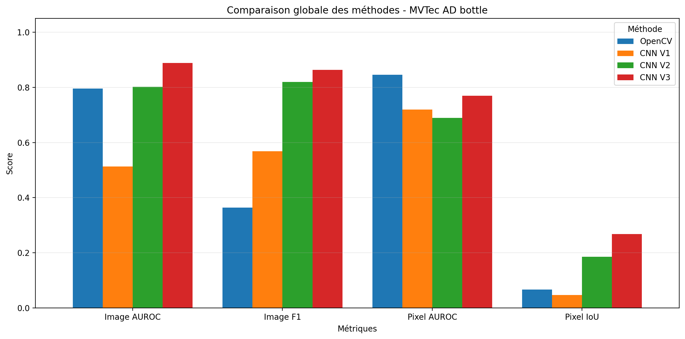
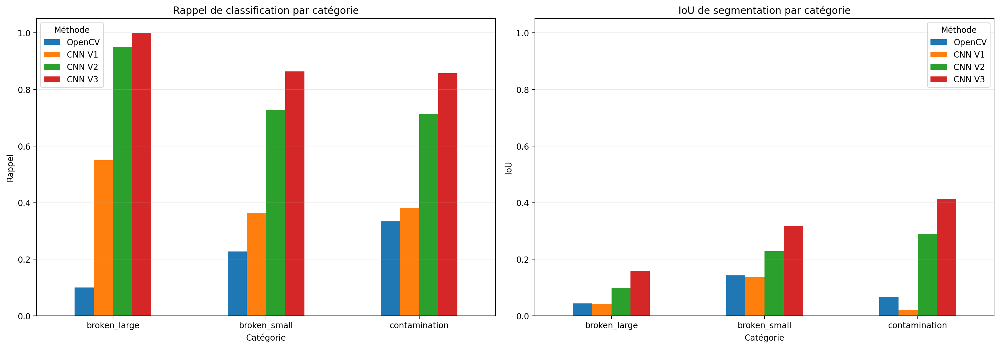
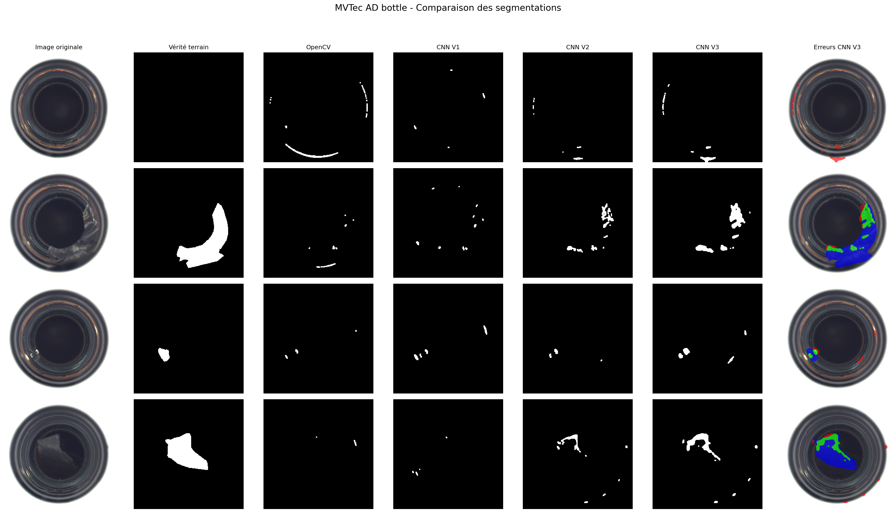

# Industrial Anomaly Detection — MVTec AD

Détection et localisation d'anomalies sur images industrielles à l'aide
d'OpenCV et d'un autoencodeur convolutif PyTorch.

## Présentation

Ce projet explore plusieurs approches de détection d'anomalies sur la
catégorie `bottle` du dataset MVTec AD.

L'objectif est de détecter la présence d'un défaut dans une image,
puis de localiser les régions suspectes à l'aide d'un masque binaire.

Quatre méthodes ont été développées et comparées :

1. **OpenCV** — Comparaison avec une image moyenne de référence.
2. **CNN V1** — Erreur de reconstruction d'un autoencodeur.
3. **CNN V2** — Normalisation spatiale des erreurs.
4. **CNN V3** — Normalisation spatiale suivie d'un lissage gaussien.

Les trois variantes CNN exploitent les mêmes poids entraînés.

## Technologies

- Python
- NumPy et pandas
- OpenCV
- PyTorch
- scikit-learn
- Matplotlib
- Google Colab (GPU)

## Dataset

**Source :** MVTec Anomaly Detection (MVTec AD)

**Catégorie étudiée :** `bottle`

Répartition utilisée :

| Ensemble | Images |
|---|---:|
| Entraînement normal | 167 |
| Validation normale | 42 |
| Test normal | 20 |
| Test défectueux | 63 |

Les images sont redimensionnées à 256 × 256 pixels.

Le dataset n'est pas inclus dans le dépôt.

## Méthodologie

### 1. Baseline OpenCV

Une image moyenne est construite à partir des images normales
d'entraînement.

Les écarts entre une nouvelle image et cette référence servent à
produire une carte d'anomalies.

### 2. Autoencodeur convolutif

Un autoencodeur est entraîné uniquement sur des images normales.

L'erreur entre l'image d'entrée et sa reconstruction sert à
identifier les régions potentiellement anormales.

Le réseau comprend un encodeur, une représentation compressée
et un décodeur.

### 3. Amélioration des cartes d'anomalies

- **CNN V1 :** erreur de reconstruction.
- **CNN V2 :** standardisation spatiale à partir des statistiques
  d'erreur sur des images normales.
- **CNN V3 :** lissage gaussien de la carte normalisée.

Des seuils calibrés sur des images normales permettent de produire
les décisions au niveau image et les masques de segmentation.

## Résultats expérimentaux

Évaluation exploratoire sur 83 images de test.

| Méthode | Image AUROC | Image F1 | Pixel AUROC | Pixel IoU |
|---|---:|---:|---:|---:|
| OpenCV | 0.7952 | 0.3636 | **0.8455** | 0.0667 |
| CNN V1 | 0.5135 | 0.5684 | 0.7199 | 0.0472 |
| CNN V2 | 0.8016 | 0.8197 | 0.6892 | 0.1857 |
| CNN V3 | **0.8881** | **0.8636** | 0.7693 | **0.2682** |

CNN V3 obtient les meilleurs résultats en classification
et en IoU de segmentation parmi les méthodes testées.

Cependant, elle produit 12 fausses alertes sur 20 images
normales, soit un taux de 60 %.

Son rappel au niveau pixel est de 31,07 %, ce qui montre que
les régions défectueuses restent partiellement segmentées.

### Comparaison globale



### Performances par catégorie



### Visualisation des segmentations



## Organisation du dépôt

- `notebooks/` : notebook principal.
- `outputs/figures/` : visualisations des résultats.
- `outputs/*.csv` : métriques expérimentales.
- `requirements.txt` : dépendances Python.
- `.gitignore` : exclusions des fichiers locaux.

## Exécution

Le notebook a été développé et vérifié sous Google Colab
avec un GPU NVIDIA Tesla T4.

Pour installer les dépendances Python :

```bash
pip install -r requirements.txt
```

Le notebook utilise actuellement des chemins Google Drive
et des ressources sauvegardées lors des expérimentations.

**Limite de reproductibilité :** les poids entraînés et les fichiers
de calibration ne sont pas inclus dans ce dépôt.

Une installation des dépendances ne suffit donc pas à reproduire
directement l'inférence : il faut également disposer du dataset,
des poids du CNN et des configurations OpenCV/CNN correspondantes.

Le parcours de restauration, d'inférence et d'évaluation a été
validé après redémarrage de l'environnement Colab, avec les
ressources existantes sur Google Drive.

## Limites

- Étude limitée à la catégorie `bottle`.
- Segmentation encore partielle.
- Taux de fausses alertes élevé pour CNN V3.
- Résultats exploratoires : les images de test ont été consultées
  pendant le développement, et ne constituent donc pas une
  évaluation indépendante définitive.

## Perspectives

- Tester une résolution supérieure.
- Améliorer la fonction de perte et l'architecture.
- Comparer l'approche à PatchCore.
- Évaluer d'autres catégories MVTec AD.
- Renforcer le protocole de validation.
